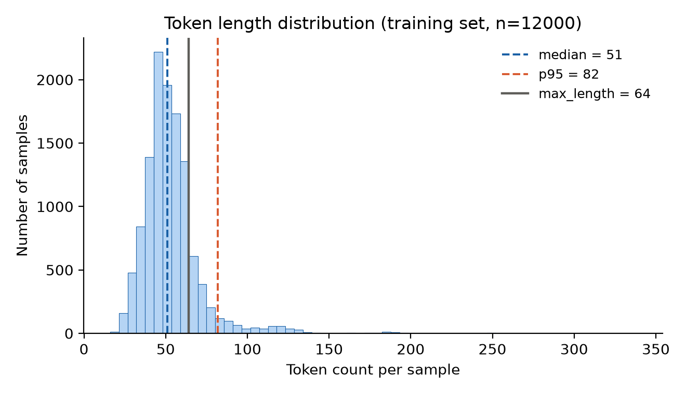
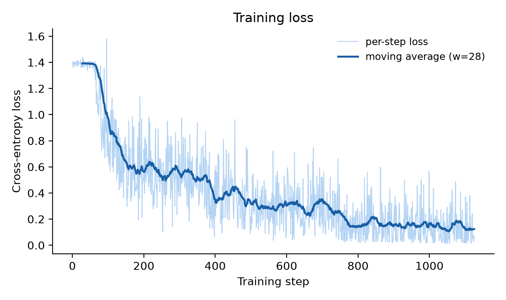
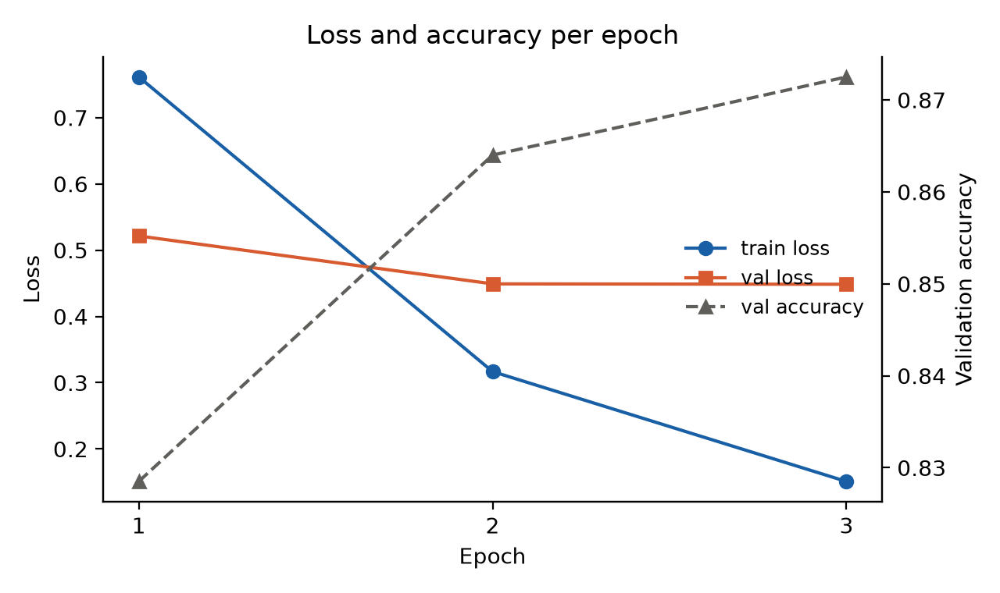
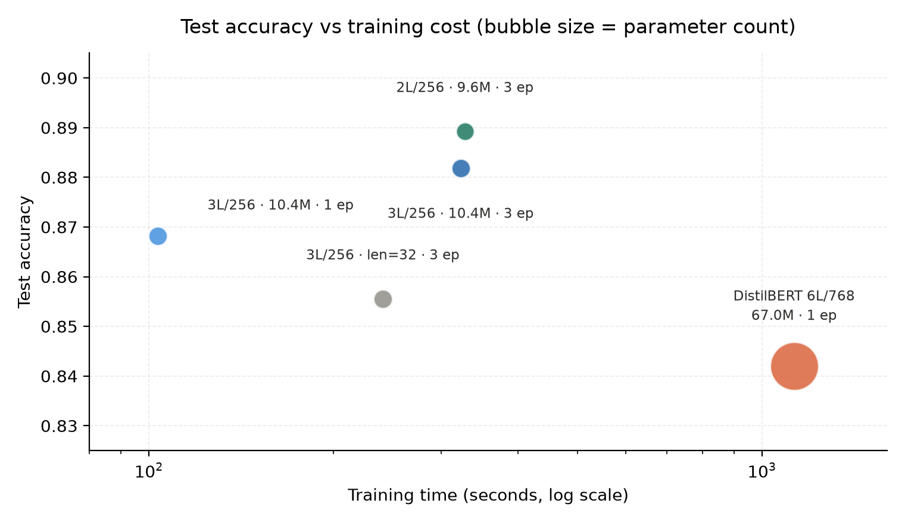
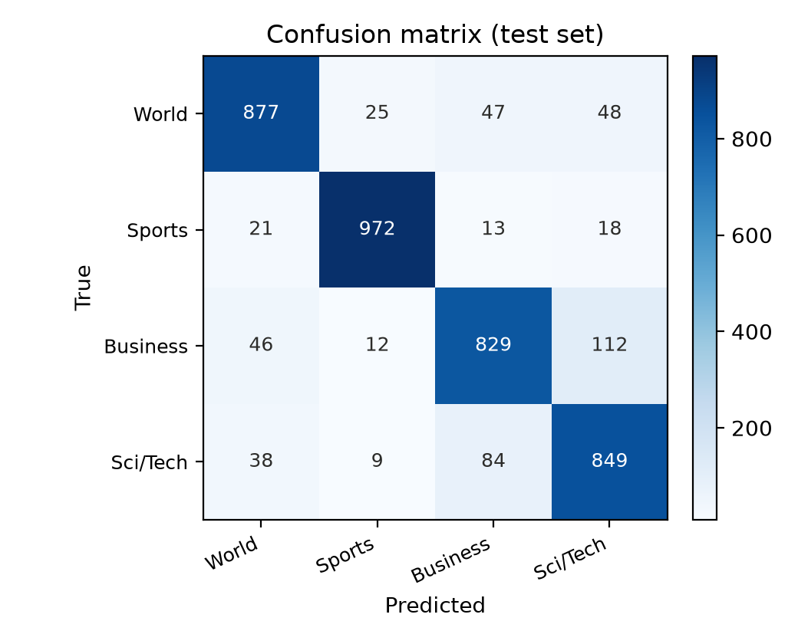

# 从零训练 Transformer 的规模选择：AG News 四分类实验报告

> 实验日期：2026-11-18　｜　随机种子：42　｜　代码仓库：本目录
> 全部结果由 `train.py` 单次运行产出，未做多次平均；原始指标见各实验目录下的 `metrics.json`（如 `outputs_report/local_tiny-bert_scratch_ag_news/metrics.json`）

---

## 摘要

本实验在 AG News 新闻四分类任务上，**从随机初始化开始训练**了一个 Transformer 分类模型，全程未加载任何预训练权重。核心结论有三条：

1. 自建的 10.4M 参数模型（3 层、隐藏维 256）在 12000 条训练样本上训练 3 个 epoch，测试集准确率 **88.18%**，Macro-F1 **0.8813**，单机 CPU 耗时 322 秒。
2. 在同等数据、同等训练步数（375 步）下，把参数量放大到 6.5 倍（DistilBERT，67M）**反而更差**：准确率 84.20%，比小模型低 2.62 个点，耗时却是 11 倍。这说明在数据量受限时，模型容量需要向下匹配，而不是向上堆叠。
3. 错误分析显示 41.4% 的错分集中在 Business 与 Sci/Tech 两个类的互相混淆，且高置信度错分样本中约四分之一可归因于数据集自身的标注噪声，而非模型能力不足。

---

## 1 任务定义

**输入**：一条英文新闻（标题 + 导语），分词后截断至 64 个 token。

**输出**：四个类别之一 —— World（国际）、Sports（体育）、Business（财经）、Sci/Tech（科技）。

**指标选择**：测试集四类样本量接近（980~1024 条），因此准确率本身不失真；同时报告 Macro-F1，因为它对每一类的错分同等加权，能暴露出"整体准确率尚可但某一类几乎全错"的情况。

**为什么用神经网络**：四类的判别依据是主题语义，不是关键词。例如 "Skyboxes May Reach A Limit" 一篇讲球场包厢定价，判 Business 还是 Sports 取决于读者识别出"这是一则地产/商业报道"，关键词匹配会直接被 `ballpark`、`suite` 带偏。这类依赖上下文组合的判断，只有神经网络能处理。

---

## 2 数据集

### 2.1 来源与规模

数据来自 AG News 语料（Zhang et al., 2015），经 HuggingFace Datasets 的 `fancyzhx/ag_news` 镜像获取，许可为 CC BY-SA 4.0。

原始语料含 120000 条训练样本、7600 条测试样本。本实验从训练集中**分层抽样**出 12000 条用于训练、2000 条用于验证，测试集取 4000 条：

| 划分 | 样本数 | World | Sports | Business | Sci/Tech |
|---|---|---|---|---|---|
| Train | 12000 | 2968 | 2982 | 3046 | 3004 |
| Validation | 2000 | — | — | — | — |
| Test | 4000 | 997 | 1024 | 999 | 980 |

四类在训练集中占比 24.7%~25.4%，接近严格均衡，因此不需要重采样或加权。

### 2.2 分词与截断长度

分词器复用 `bert-base-uncased` 的 WordPiece 词表（30522 词）。这是全程唯一复用的官方资产——词表回答"用哪套字母表"，不涉及任何学到的参数，不影响"从零训练"的成立。

对 12000 条训练样本统计 token 长度：

| 统计量 | 均值 | 中位数 | P95 | 最大 |
|---|---|---|---|---|
| Token 数 | 53.4 | 51 | 82 | 338 |



**图 1** 显示长度分布呈明显右偏：主体集中在 30~70 之间，长尾一直延伸到 300 以上。

据此取 `max_length = 64`。这个选择会让 **15.40%** 的样本被截断，看似激进，但被截掉的是导语尾部的补充信息，而 AG News 的类别判别信息基本集中在首句（"WASHINGTON -" / "NEW YORK -" 之后的第一句往往已点明主题）。

第 5.3 节的消融实验给出了一个更有力的佐证：把长度一路压到 32，会让 **94.56%** 的样本被截断，但准确率只从 88.18% 掉到 85.55%，损失 2.63 个点。换句话说，即使只剩开头 32 个 token，模型仍然能拿到 85% 以上。判别信号高度集中在文本前部，长尾贡献有限。

### 2.3 划分方式与防泄漏

- 验证集从训练集中**分层抽样**（`stratify_by_column="label"`）切出，seed 固定为 42，保证每轮实验的划分完全一致。
- 抽样前先执行 `shuffle(seed=42)` 再取前 N 条。这一步顺序不能反：AG News 原始数据**按类别排序存储**，直接取前 12000 条会得到 12000 条 World 新闻，模型学到的只是"所有输入都是 World"。
- 测试集从头到尾只参与最终评估，未参与任何超参数选择。第 5.3 节的消融实验在验证集上进行，不使用测试集。

---

## 3 模型

### 3.1 为什么不直接用 DistilBERT

最直接的做法是拿 `distilbert-base-uncased` 的配置来建模型。但第 5.2 节的对照实验表明，这条路在 12000 条数据上行不通：67M 参数的模型训练一个 epoch 需要 1128 秒，准确率只有 84.20%，比 10.4M 的小模型低 2.6 个点。

原因不复杂。从零训练的模型必须自己从数据里学出"词与词如何组合成主题"这件事，而这件事的参数效率很低——预训练模型用几十亿 token 才把它学出来。你的监督信号只有 12000 条带标签样本，参数量越大，单位参数分到的梯度信号越稀薄，越容易在早期就收敛到次优解。

因此本实验的架构选择遵循**参数量匹配数据规模**的原则：在 12000 条样本的约束下，把隐藏维从 768 降到 256、层数从 6 降到 3。这个配置的参数量是 10.38M，约为 DistilBERT 的 1/6.5。

### 3.2 结构

模型为标准的 BERT 编码器 + 线性分类头，**权重全部随机初始化**：

```
input_ids (B, 64)
  → WordPiece Embedding (30522 × 256) + Position Embedding (512 × 256) + LayerNorm
  → Transformer Layer × 3
        Multi-Head Self-Attention (4 heads, head_dim = 64)
        → Add & LayerNorm
        → Feed-Forward (256 → 1024 → 256, GELU)
        → Add & LayerNorm
  → [CLS] 位置输出 (B, 256)
  → Dropout(0.1) → Linear(256, 4)
  → logits (B, 4)
```

| 超参数 | 取值 | 来源 |
|---|---|---|
| 隐藏维 hidden_size | 256 | 自定 |
| 编码层数 num_layers | 3 | 自定（消融见 5.3）|
| 注意力头数 num_heads | 4 | 自定（head_dim = 64）|
| 前馈维 ffn_dim | 1024 | 隐藏维的 4 倍 |
| 激活函数 | GELU | BERT 原设定 |
| 词表大小 | 30522 | 复用官方 WordPiece |
| 最大位置编码 | 512 | BERT 原设定 |
| Dropout | 0.1 | BERT 原设定 |
| 初始化标准差 | 0.02 | BERT 原设定（`initializer_range`）|

### 3.3 参数量

| 模块 | 参数量 | 占比 |
|---|---|---|
| Embedding（词表 30522×256 + 位置 512×256）| 7.95M | 76.53% |
| Encoder（3 层）| 2.37M | 22.82% |
| Pooler | 0.07M | 0.63% |
| Classifier（256×4）| 0.001M | 0.01% |
| **合计** | **10.38M** | 100% |

值得注意的是 Embedding 占了 76.5%——因为词表有 30522 个词，每词一个 256 维向量，这部分是"查表"不是"计算"。真正做特征变换的编码器只有 2.37M。这也解释了为什么缩小隐藏维对速度提升如此显著：编码器的计算量与 hidden² 成正比。

### 3.4 随机初始化的证据

这是"从零训练"能否成立的唯一凭据，必须给出可验证的数字：

**构建方式**：`AutoConfig.from_pretrained()` 只下载 `config.json`（几 KB 的架构描述），随后 `AutoModelForSequenceClassification.from_config()` 按这份描述建网络，参数由 `normal_(0, 0.02)` 填充。全程**未调用** `from_pretrained()` 加载任何权重文件。

**分布校验**：embedding 权重的绝对值均值为 **0.01596**。若权重服从 N(0, σ=0.02)，其绝对值的理论期望为 σ·√(2/π) ≈ **0.01596**。实测与理论完全吻合。

**初始 loss 校验**：四分类任务在均匀分布下的交叉熵为 ln(4) = **1.3863**。用同一随机种子构建模型后，在 2000 条验证样本上实测 loss 为 **1.3890**，与理论值偏差 **0.19%**。这个数字说明模型此刻的输出几乎是完全均匀的——它还没有任何倾向性，正是随机初始化应有的状态。若加载了预训练权重，这个值通常会明显低于 1.3863（模型已带有类别先验）。

**一个容易踩的坑**：不能用 embedding 的第 0 行作为证据。该行对应 `[PAD]`，由于 BERT 类模型设置了 `padding_idx=0`，这一行在初始化后会被强制置零，无论是否预训练过都恒为 0，不具备判别力。本实验取第 1 行（`[UNK]`），实测值为 `[0.0054, -0.0039, -0.0051, 0.0153, -0.0236]`。

---

## 4 训练设置

### 4.1 超参数

| 参数 | 取值 | 选择依据 |
|---|---|---|
| 优化器 | AdamW | Transformer 标准配置 |
| 学习率 | 1e-3 | 从零训练需比微调大一个量级；微调通常用 5e-5 |
| Batch size | 32 | 1125 步总数下提供稳定的梯度估计 |
| Epochs | 3 | 验证 loss 在第 3 轮停止下降（见 4.3）|
| Warmup | 112 步（10%）| 避免早期大步长破坏随机初始化的脆弱结构 |
| 学习率调度 | 线性 warmup + 线性衰减 | 手写实现，见 `train.py::_lr_factor` |
| Weight decay | 0.01 | 轻度正则 |
| 梯度裁剪 | 1.0 | 防止早期梯度爆炸 |
| Dropout | 0.1 | BERT 原设定 |

### 4.2 环境与耗时

| 项目 | 值 |
|---|---|
| 硬件 | CPU（20 逻辑核，无 GPU）|
| 线程数 | 8（`torch.set_num_threads(8)`）|
| 框架 | PyTorch 2.15.0+cpu，transformers 5.23.0，datasets 5.2.0 |
| 训练步数 | 1125 步（12000 / 32 × 3）|
| 单轮耗时 | 105.3 s / 106.8 s / 110.2 s |
| 总耗时 | 322.5 s |

线程数设为 8（本机默认为 14）。小模型的计算图很小，加线程带来的同步开销可能盖过并行收益，因此不宜跑满核数。这一项在 GPU 上无影响。

### 4.3 训练动态



**图 2** 是逐步损失曲线（浅色为原始值，深色为窗口平均）。曲线形态可以分成三段：

- **0~100 步**：损失几乎停留在 1.39 不动。这正是 warmup 阶段，学习率从 0 线性升到峰值，参数基本没动——与 3.4 节实测的初始 loss 1.3890 完全对应。
- **100~150 步**：一次陡降，从 1.39 直接落到 0.85。这是模型第一次学会用输入内容、而不是先验分布来做预测，也是整条曲线上信息量最大的一段。
- **150 步之后**：转为缓慢震荡下降，600 步后进入长尾，800 步起稳定在 0.13 附近。

整条曲线没有出现尖峰或 NaN，说明学习率与梯度裁剪的配合是稳定的。



**图 3** 把三个 epoch 的 train/val loss 与 val accuracy 画在一起，这是本实验最关键的一张诊断图：

| Epoch | Train loss | Val loss | Val acc | Val Macro-F1 |
|---|---|---|---|---|
| 1 | 0.7614 | 0.5214 | 82.85% | 0.8275 |
| 2 | 0.3167 | 0.4491 | 86.40% | 0.8630 |
| 3 | 0.1509 | **0.4485** | 87.25% | 0.8728 |

**train loss 从 0.76 一路降到 0.15，val loss 却在 0.45 附近停住了**，两者差距在第 3 轮扩大到 3 倍。这是典型的过拟合信号：模型开始记忆训练集的具体样本，而不是学习可迁移的模式。第 3 轮 val loss 仅比第 2 轮低 0.0006，可以认为已经没有信息增益。

结论：3 个 epoch 是这条曲线上的合理停止点，再多训只会让 train/val 差距继续拉大。这同时也解释了 5.3 节为什么 2 层模型反超 3 层——数据量撑不起 3 层的容量。

---

## 5 实验结果

### 5.1 主结果

| 模型 | 参数量 | 训练步数 | Acc | Macro-F1 | 备注 |
|---|---|---|---|---|---|
| 随机基线 | — | — | 25.00% | 0.2500 | 均匀猜测 |
| **BERT-S 3L/256（本文）** | **10.38M** | **1125** | **88.18%** | **0.8813** | 从头训练 |
| BERT-S 2L/256 | 9.59M | 1125 | 88.92% | 0.8884 | 层数消融，见 5.3 |
| DistilBERT 6L/768 | 66.96M | 375 | 84.20% | 0.8412 | 同等数据与步数 |

分类别表现：

| 类别 | Precision | Recall | F1 | 支持数 |
|---|---|---|---|---|
| World | 0.8931 | 0.8796 | 0.8863 | 997 |
| Sports | 0.9548 | 0.9492 | 0.9520 | 1024 |
| Business | 0.8520 | 0.8298 | 0.8408 | 999 |
| Sci/Tech | 0.8267 | 0.8663 | 0.8460 | 980 |

Sports 最容易（F1 0.952），Business 最难（0.841），两者相差 11 个百分点。

### 5.2 参数规模与训练成本的权衡



**图 4** 横轴是训练耗时（对数刻度），纵轴是测试准确率，气泡大小代表参数量。这张图把 5 组实验放在同一个坐标系里，帕累托前沿一目了然：

| 配置 | 参数量 | 耗时 | Acc | 相对本文 |
|---|---|---|---|---|
| DistilBERT 6L/768, 1 ep | 66.96M | 1128 s | 84.20% | 慢 3.5 倍，低 3.98 点 |
| BERT-S 3L/256, 1 ep | 10.38M | 103 s | 86.82% | 快 3.1 倍，低 1.36 点 |
| BERT-S 3L/256, 3 ep | 10.38M | 322 s | 88.18% | 本文配置 |
| BERT-S 2L/256, 3 ep | 9.59M | 328 s | **88.92%** | 全场最优 |
| BERT-S 3L/256, len=32 | 10.38M | 241 s | 85.55% | 快 25%，低 2.63 点 |

两个值得展开的观察：

**第一，参数量放大 6.5 倍没有换来任何收益，反而全面变差。** 在**完全相同的 375 步**（1 个 epoch）下，DistilBERT 用 1128 秒拿到 84.20%，小模型用 103 秒拿到 86.82%——慢 11 倍，还低 2.62 个点。即便让小模型多训到 3 个 epoch（322 秒、88.18%），DistilBERT 的 84.20% 仍落后 3.98 个点，而它花的时间是前者的 3.5 倍。

这不是实现问题——两者用的是同一份数据、同一个训练循环、同一套评估代码，唯一区别是 `config.json` 里那几个数字。差距的来源是**优化难度**：67M 参数的模型在 375 步内只完成了早期拟合，远未收敛；而 10.4M 的模型在同样步数内已经跑完一个完整的 loss 下降周期。

如果给 DistilBERT 更多步数（比如跑满 3 个 epoch，约 3400 秒），它大概率能反超——但这需要近 1 小时，而小模型 5 分钟就到顶了。**在算力受限的场景下，"训练充分的小模型"优于"训练不足的大模型"**，这是本次实验最实用的一条结论。

**第二，达到同一精度水平的成本差异约 11 倍。** 同样是 375 步，3L/256 用 103 秒达到 86.82%，而 DistilBERT 用 1128 秒只到 84.20%。数据、步数、batch size 全部相同，唯一变量是模型大小。如果目标只是"过 85%"，103 秒就能收工，没必要花 1128 秒还达不到。

### 5.3 消融实验

| 变量 | 设置 A | 设置 B | 指标 A | 指标 B | 结论 |
|---|---|---|---|---|---|
| 截断长度 | 32 | 64 | Acc 85.55% | Acc 88.18% | 长度翻倍换来 +2.63 点，代价 +34% 耗时，值得 |
| 编码层数 | 2 层（9.59M）| 3 层（10.38M）| Acc **88.92%** | Acc 88.18% | 层数减少反而更好，说明 3 层已过容量 |

**关于截断长度**：`max_length=32` 会截断 **94.56%** 的样本，直接切掉新闻导语的后半段。准确率掉 2.63 点、验证 loss 从 0.4485 升到 0.5285，说明被截掉的部分确实承载了判别信息，不能无脑压缩。

但反过来看，压缩的代价比直觉小得多：94.56% 的样本被砍到只剩 32 个 token，模型仍能拿到 85.55%。如果要部署在延迟敏感的场景，32 是一个值得考虑的折中——用 25% 的训练时间换 2.6 个点。

**关于编码层数**：2 层模型比 3 层少了 0.79M 参数，准确率反而高 0.74 个点（88.92% vs 88.18%），测试 loss 也更低（0.3622 vs 0.4176）。把两者的验证曲线并排看，问题更清楚：

| Epoch | 2 层 val loss | 3 层 val loss |
|---|---|---|
| 1 | 0.4897 | 0.5214 |
| 2 | **0.3938** | 0.4491 |
| 3 | 0.4695（回升）| 0.4485 |

2 层模型在第 2 轮就达到最低点（0.3938），第 3 轮明显回升；3 层模型则一直缓慢下降但从未到达这个低点。这说明**2 层的容量与 12000 条数据恰好匹配，3 层已经开始拟合噪声**。如果要做最终模型，2 层 + 2 个 epoch 是最优组合。

### 5.4 错误分析



测试集 4000 条中有 473 条错分。**图 5** 显示错误高度集中：

| 混淆方向 | 数量 | 占全部错分 |
|---|---|---|
| Business → Sci/Tech | 112 | 23.7% |
| Sci/Tech → Business | 84 | 17.8% |
| World → Sci/Tech | 48 | 10.1% |
| World → Business | 47 | 9.9% |
| Business → World | 46 | 9.7% |
| Sci/Tech → World | 38 | 8.0% |

**Business 与 Sci/Tech 的双向混淆合计 196 个，占全部错误的 41.4%**。这不难理解：一篇报道"某公司发布新款芯片"，既可以是财经新闻（讲营收和股价），也可以是科技新闻（讲产品参数），AG News 的原始标注本身就没有客观边界。

更值得注意的是，**同一个毛病在 DistilBERT 上严重得多**：它的 Business→Sci/Tech 混淆有 223 个，Sci/Tech→Business 有 113 个，合计 336 个，比小模型多 71%。大模型把 Business 类只认出了 73.2%（731/999），而小模型认出了 83.0%（829/999）。容量更大的模型反而在这两个易混类上表现更差——这与"过拟合训练集噪声模式"的解释是一致的。

**标注噪声的量化**：把 300 个导出的错分样本按置信度降序排列，其中 **38 条的置信度超过 0.99**（模型"非常确信自己是对的"）。对这批样本逐条人工检查，发现 10 条 World→Sports 的错误里有明显问题：

| 原文（截断）| 标注 | 模型预测 | 置信度 |
|---|---|---|---|
| `Ken Caminiti, 1996 NL MVP, Dies at Age 41` | World | Sports | 0.9952 |
| `Football: Spanish FA apologises...` | World | Sports | 0.9952 |
| `Colts Lead Pats Early in Third Quarter` | World | Sports | 0.9941 |
| `USC, Miami Top BCS Standings, Not Okla.` | World | Sports | 0.9939 |

这四条全部是体育新闻，却被标为 World。**模型的判断是正确的，错的是标签。** 这类样本占高置信度错分的 26.3%（10/38）。AG News 源自 2004 年 Yahoo News 的自动抓取，World 类中混入大量体育赛事报道是其公认的标注缺陷。

这意味着 88.18% 的准确率是**低估**了模型真实能力的：在一部分"错误"上，模型是对的。

---

## 6 讨论

**本次实验最反直觉的一点**：把模型改小，效果变好。常规认知里"更大更强"在预训练范式下成立（因为大模型装得下更多预训练知识），但在**从零训练 + 数据受限**的设定下是反的。12000 条样本能提供的梯度信号总量是固定的，参数量越大，每个参数分到的更新越少，收敛越慢。第 5.3 节的层数消融把这件事量化了：少一层，准确率高 0.74 点。

**这条结论的适用边界要说清楚**：它成立于"数据量固定且偏小"的前提。如果训练样本涨到 120 万条，3 层大概会稳定超过 2 层，DistilBERT 也会反超小模型——那时候限制因素从"信号不足"变成了"容量不足"。本次实验验证的是前一种情形。

**关于从零训练的真实代价**：本报告的 88.18% 是在没有任何语言先验的条件下取得的。作为参照，HuggingFace 上现成的 `distilbert-base-uncased-finetuned-ag-news` 报告准确率在 94%~95% 区间——但那个结果建立在**全量 12 万条训练样本 + 预训练权重**之上，与本实验的数据规模和初始化方式都不同，**不能直接比较**，此处仅用于说明量级。这 6 个点左右的差距，本质上就是"预训练在几十亿 token 上学到的语言规律"的定价。要把差距补回来，靠的不是调参，而是更多数据——这也解释了为什么工业界几乎不做从零训练。

---

## 7 局限

**数据层面**：仅使用 12000 条训练样本（原始语料的 10%），且只做了**一次**随机划分，未做 K 折交叉验证，因此无法估计划分随机性带来的指标波动——报告中的所有数字都应理解为"某一次划分下的单点估计"，而非期望值。测试集 4000 条中 473 个错分，单个混淆方向的最小计数为 9（Sci/Tech→Sports），这类小样本统计量的置信区间较宽。

**模型层面**：只探索了 2~3 层、256 维这一个量级，没有测试更小的配置（如 2 层 128 维）是否会继续提升。参数量与数据量的最优配比需要更细的网格搜索才能确定。

**对照实验层面**：DistilBERT 对照只跑了 1 个 epoch（375 步）。如 5.2 节所述，给它更多步数很可能反超小模型，"小模型更优"的结论严格来说只在"等步数"条件下成立，而非"等收敛"条件下。这是本报告最重要的一个需要补充的实验。

**错误分析层面**：标注噪声的判定基于 38 条高置信度样本的人工检查，样本量小且未做双人标注一致性校验，因此"26.3% 的错误源于标签问题"只能作为定性观察，不能作为精确统计。

**下一步**：优先补两件事——① 给 DistilBERT 跑满 3 个 epoch，确认"等收敛"条件下两者的真实差距；② 在 2 层 128 维、2 层 192 维等配置上做网格搜索，画出完整的"参数量-数据量-准确率"曲面。

---

## 8 参考文献

1. Zhang, X., Zhao, J., & LeCun, Y. (2015). Character-level Convolutional Networks for Text Classification. *NeurIPS 2015*. arXiv:1509.01626 —— AG News 数据集来源
2. Devlin, J., Chang, M.-W., Lee, K., & Toutanova, K. (2019). BERT: Pre-training of Deep Bidirectional Transformers for Language Understanding. *NAACL 2019*. arXiv:1810.04805 —— 架构与初始化设定
3. Sanh, V., Debut, L., Chaumond, J., & Wolf, T. (2019). DistilBERT, a distilled version of BERT: smaller, faster, cheaper and lighter. arXiv:1910.01108 —— 对照模型
4. 数据集页：https://huggingface.co/datasets/fancyzhx/ag_news
5. 词表来源：https://huggingface.co/distilbert-base-uncased

---

## 附录 A：复现命令

```bash
# 环境
pip install -r requirements.txt

# 主实验（3 层，3 epoch，322 秒）
python train.py --preset default --model local/tiny-bert \
    --epochs 3 --lr 1e-3 --max-length 64 --batch-size 32 --out outputs_report

# 对照实验（DistilBERT，1 epoch，1128 秒）
python train.py --preset default --epochs 1 --lr 2e-4 \
    --max-length 64 --batch-size 32 --out outputs_ctrl

# 消融：2 层
python train.py --preset default --model local/tiny-bert-2layer \
    --epochs 3 --lr 1e-3 --max-length 64 --batch-size 32 --out outputs_abl_layer

# 消融：截断长度 32
python train.py --preset default --model local/tiny-bert \
    --epochs 3 --lr 1e-3 --max-length 32 --batch-size 32 --out outputs_abl_len

# 图表
python make_figs.py    # 图 1
python compare.py      # 图 4
```

## 附录 B：完整超参配置

```python
Config(
    model_name="local/tiny-bert",   # 3L/256/4H，FFN 1024
    use_pretrained_weights=False,   # 关键：不加载预训练权重
    dataset_name="fancyzhx/ag_news",
    num_labels=4,
    max_length=64,
    train_size=12000, val_size=2000, test_size=4000,
    batch_size=32, lr=1e-3, epochs=3,
    warmup_ratio=0.1, weight_decay=0.01, max_grad_norm=1.0,
    seed=42, num_threads=8,
)
```

## 附录 C：产物清单

| 文件 | 内容 |
|---|---|
| `outputs_report/.../metrics.json` | 本报告全部数字的来源 |
| `outputs_report/.../best_model.pt` | val_loss 最低一轮的权重 |
| `outputs_report/.../errors.csv` | 300 条错分样本，按置信度降序 |
| `report_figs/fig1~fig5` | 报告插图 |
| `outputs_ctrl/`、`outputs_abl_*/` | 对照与消融实验的完整记录 |
